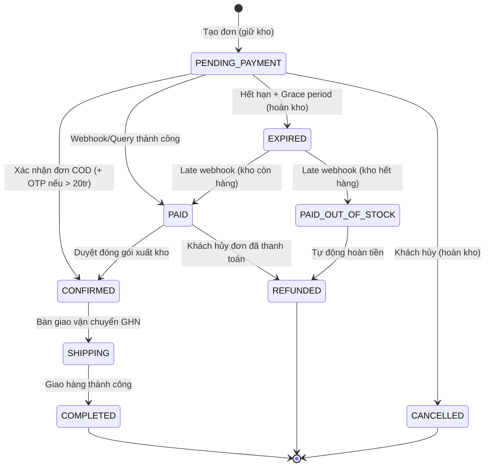

# PhoneStoreManagementSystem 📱

Hệ thống Quản lý Cửa hàng Bán lẻ Điện thoại di động (CellphoneS) - Kiến trúc Feature-Based ASP.NET Core (.NET 10) & PostgreSQL.

[](https://github.com/OWNER/REPOSITORY/actions/workflows/ci.yml)

---

## 🏗️ Kiến trúc Tổng quan

- **Backend**: C# ASP.NET Core Web API (.NET 10)
  - Kiến trúc: **Feature-Based Architecture (Vertical Slice)**
  - ORM: **Entity Framework Core 10** với **Npgsql PostgreSQL**
  - Xác thực: **JWT Bearer Authentication & BCrypt**
  - Validation: **FluentValidation**
  - Tài liệu API: **Swagger / OpenAPI (v1)** với hỗ trợ Bearer Token
- **Database**: **PostgreSQL 16** (Khởi tạo tự động qua `database/init-postgres.sql`)
- **Frontend**: Nginx Alpine phục vụ giao diện Web & Reverse Proxy sang Backend
- **DevOps**: Docker, Docker Compose (Dev & Prod), GitHub Actions CI

---

## 🚀 Khởi chạy dự án cục bộ

### Cách 1: Sử dụng Docker Compose (Khuyên dùng)

1. Sao chép file cấu hình môi trường mẫu:
   ```bash
   cp .env.example .env
   ```
2. Khởi động toàn bộ hệ thống (PostgreSQL + Backend + Frontend):
   ```bash
   docker compose up -d --build
   ```
3. Truy cập hệ thống:
   - **Giao diện Khách hàng**: [http://localhost](http://localhost)
   - **Giao diện Quản trị**: [http://localhost/admin](http://localhost/admin)
   - **Swagger API (Dev)**: [http://localhost:8080/swagger](http://localhost:8080/swagger)
   - **Health Check API**: [http://localhost:8080/api/health](http://localhost:8080/api/health)

4. Dừng container:
   ```bash
   docker compose down
   ```

### Cách 2: Chạy Backend trực tiếp qua .NET CLI

1. Cài đặt .NET 10 SDK: [https://dotnet.microsoft.com](https://dotnet.microsoft.com)
2. Khởi chạy PostgreSQL qua Docker:
   ```bash
   docker compose up -d postgres
   ```
3. Chạy Backend:
   ```bash
   dotnet build PhoneStoreManagementSystem.slnx
   dotnet run --project backend/PhoneStoreAPI.csproj
   ```

---

## 🔄 Quy trình GitHub Actions CI (Continuous Integration)

Workflow CI tự động kích hoạt khi có `push` hoặc `pull_request` vào các nhánh `main`, `develop`, `feature/**`, `bugfix/**`.

Workflow bao gồm 3 jobs song song:

1. **`backend-ci`**:
   - Cài đặt .NET 10 SDK.
   - Cache các NuGet packages nhằm tăng tốc độ build.
   - Restore và biên dịch solution `PhoneStoreManagementSystem.slnx` ở chế độ `Release`.
   - Chạy automated tests (`dotnet test`).

2. **`database-ci`**:
   - Khởi động service container PostgreSQL 16.
   - Thực thi script `database/init-postgres.sql`.
   - Kiểm tra toàn bộ 22 bảng, khóa ngoại, constraints, triggers và views được tạo chính xác.

3. **`docker-ci`**:
   - Kiểm tra tính hợp lệ cú pháp `docker compose config` cho cả môi trường Dev và Production.
   - Build kiểm tra Docker image cho `backend` (.NET 10 multi-stage).
   - Build kiểm tra Docker image cho `frontend` (Nginx Alpine).

---

## 👥 Hướng dẫn làm việc nhóm qua Git

1. Clone dự án và tạo nhánh mới từ `develop`:
   ```bash
   git checkout develop
   git pull origin develop
   git checkout -b feature/<ten-tinh-nang>
   ```
2. Thực hiện code trong feature tương ứng trong `backend/Features/<FeatureName>/`:
   - `Controllers/`
   - `DTOs/`
   - `Services/`
   - `Validators/`
3. Commit và push lên GitHub:
   ```bash
   git add .
   git commit -m "feat(products): them API quan ly mat hang"
   git push origin feature/<ten-tinh-nang>
   ```
4. Tạo **Pull Request** vào nhánh `develop` trên GitHub. Chờ CI chạy xanh (Pass 3/3 jobs) trước khi merge.

---

## 🛒 Module Giỏ Hàng & Thanh Toán (Cart & Checkout System)

Hệ thống xử lý đơn hàng và thanh toán trực tuyến bảo toàn tính đúng đắn (Zero-Overselling, Zero-Money-Loss, Idempotency):

### 1. Sơ đồ State Machine Đơn hàng



### 2. Thông số Cấu hình Hệ thống (`appsettings.json`)

| Tham số | Giá trị mặc định | Ý nghĩa |
|---|---|---|
| `ReservationTtlMinutes` | 10 phút | Thời gian giữ tồn kho của đơn hàng sau khi tạo |
| `GracePeriodMinutes` | 5 phút | Thời gian ân hạn cho phép thanh toán quét QR phút 9:59 |
| `MaxQtyPerOrder` | 2 chiếc | Số lượng tối đa cho mỗi dòng sản phẩm trên đơn |
| `ExpireJobIntervalMinutes` | 1 phút | Chu kỳ tiến trình nền quét và giải phóng đơn quá hạn |

### 3. Hướng dẫn Chạy Kiểm thử Tự động (Automated Tests)

```bash
# Chạy toàn bộ 128 tests (Unit, Concurrency, State Machine, Reconciliation):
dotnet test

# Chạy riêng các bài test cốt lõi theo từng Task:
dotnet test --filter "FullyQualifiedName~Task1SchemaTests"
dotnet test --filter "FullyQualifiedName~Task2CartTests"
dotnet test --filter "FullyQualifiedName~Task3OrderTests"
dotnet test --filter "FullyQualifiedName~Task4StateMachineTests"
dotnet test --filter "FullyQualifiedName~Task5PaymentWebhookTests"
dotnet test --filter "FullyQualifiedName~Task6ExpirationTests"
dotnet test --filter "FullyQualifiedName~Task7RefundAndCancellationTests"
dotnet test --filter "FullyQualifiedName~Task8PromotionAndShippingTests"
dotnet test --filter "FullyQualifiedName~Task9And10AbuseAndReconciliationTests"
```
