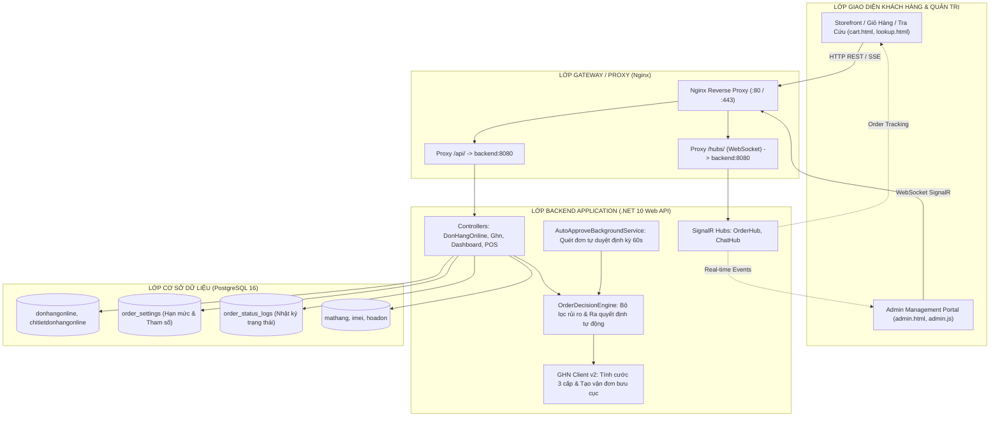
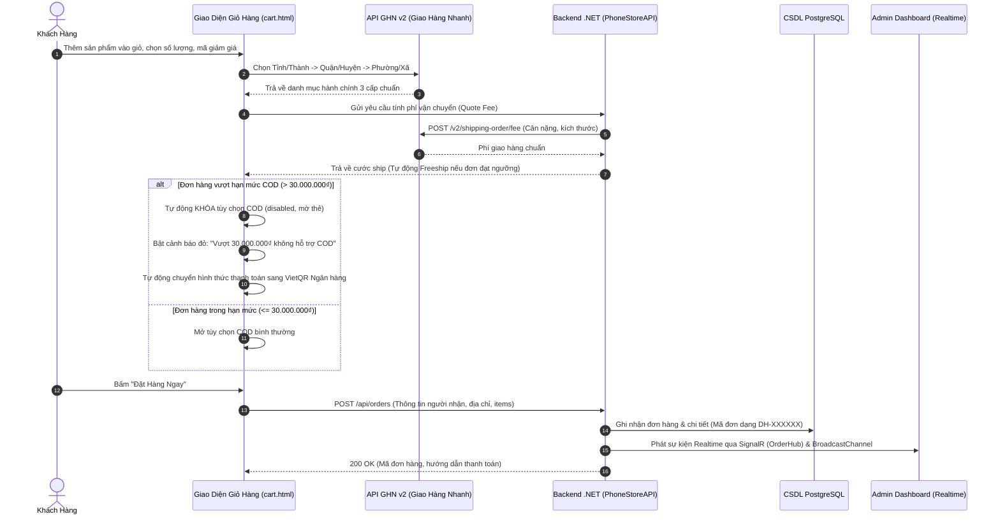
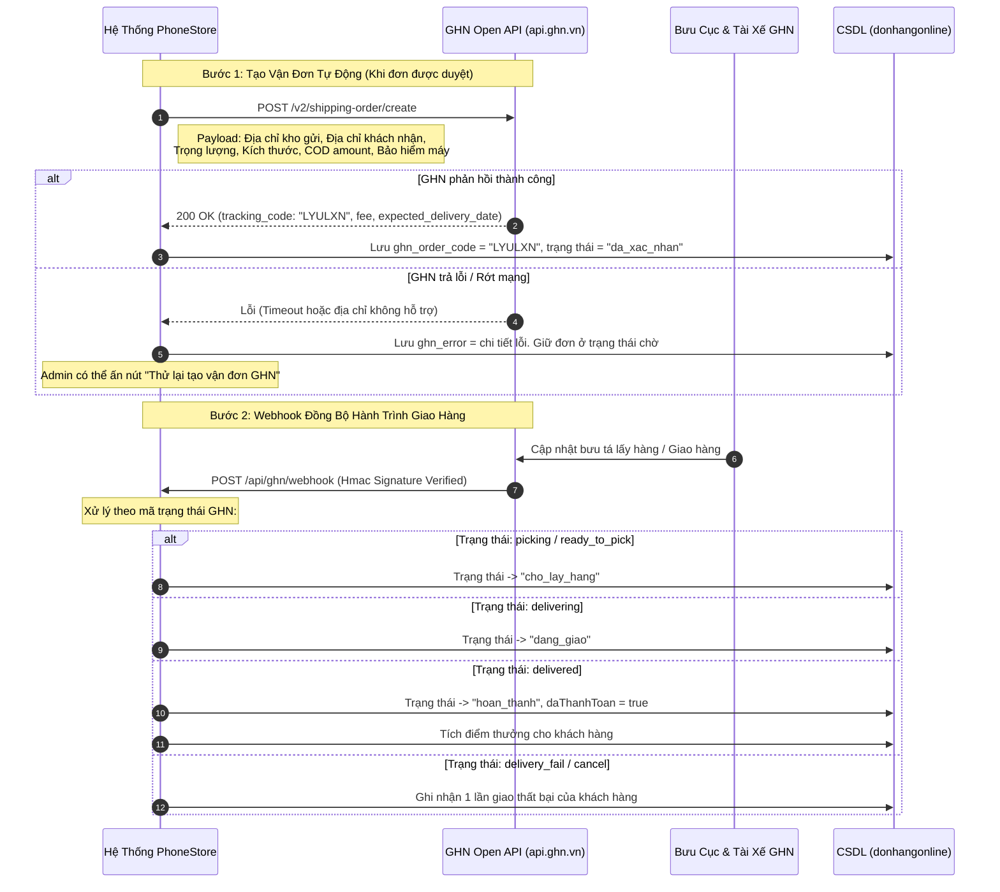
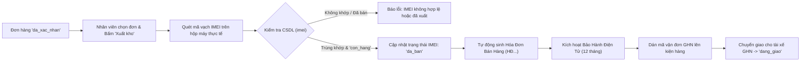
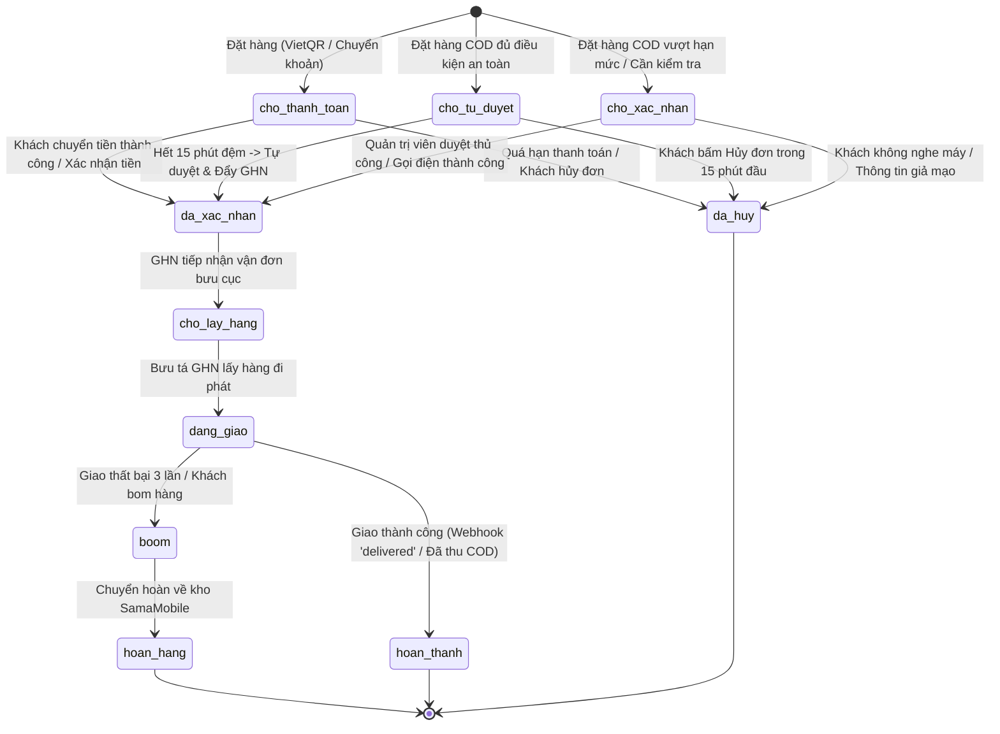

# TÀI LIỆU LUỒNG HOẠT ĐỘNG TOÀN DIỆN HỆ THỐNG
## PhoneStore Management System — SamaMobile / CellphoneS
> **Phiên bản tài liệu:** 2.0 (Cập nhật sau Plan 8 - Engine Tự Duyệt & Tích hợp GHN)  
> **Ngày cập nhật:** 14/11/2026  
> **Môi trường hoạt động:** Docker Microservices (.NET 10 Web API, PostgreSQL 16 Alpine, Nginx Reverse Proxy, GHN v2 Sandbox/Production)

---

## 1. TỔNG QUAN KIẾN TRÚC TOÀN HỆ THỐNG

Hệ thống được thiết kế theo mô hình kiến trúc phân lớp hướng dịch vụ (Clean Architecture & Microservices), đồng bộ thời gian thực đa chiều (Realtime Multi-channel Sync):



---

## 2. LUỒNG 1: ĐẶT HÀNG & KIỂM SOÁT RỦI RO PHÍA KHÁCH HÀNG

### 2.1. Quy trình các bước thực tế (Storefront Checkout)


### 2.2. Các quy tắc nghiệp vụ quan trọng ở giỏ hàng
1. **Chặn Ship COD trên 30 triệu đồng (`COD_MAX_LIMIT = 30.000.000₫`)**:
   - Khách mua các dòng máy flagship (như iPhone 16 Pro Max, Samsung Galaxy Z Fold...) với tổng đơn vượt 30 triệu sẽ **không thể tích chọn COD**.
   - Giao diện làm mờ, vô hiệu hóa radio COD và bắt buộc khách thanh toán online qua Chuyển khoản VietQR / Thẻ / Ví điện tử.
   - Kiểm tra 2 lớp: Chặn tương tác ở UI và chặn kiểm tra logic tại `submitCheckoutOrder`.
2. **Miễn phí vận chuyển thông minh theo khu vực (Smart Freeship Progress)**:
   - **Nội thành TP. Hồ Chí Minh** (`ProvinceID = 202`): Đơn từ **5.000.000₫** trở lên được Freeship 100%.
   - **Các tỉnh thành toàn quốc**: Đơn từ **20.000.000₫** trở lên được Freeship.
   - Thanh tiến trình hiển thị rõ khách còn cần mua thêm bao nhiêu tiền để nhận ưu đãi Freeship.
3. **Lọc dữ liệu rác Sandbox GHN**:
   - Tự động lọc bỏ các bản ghi kiểm thử của GHN (như *"Hà Nội 02"*, *"Test - Alert - Tỉnh - 001"*) để giao diện khách hàng luôn sạch đẹp.

---

## 3. LUỒNG 2: BỘ LỌC RỦI RO & ĐỘNG CƠ RA QUYẾT ĐỊNH TỰ ĐỘNG (ORDER DECISION ENGINE)

Ngay khi đơn hàng được ghi nhận, `OrderDecisionEngine` phân tích đơn theo quy tắc rủi ro của **Plan 8**:

```mermaid
flowchart TD
    Start([Đơn hàng mới tạo]) --> CheckBlacklist{SĐT có trong Blacklist?<br/>Số lần bom hàng >= 2?}
    
    CheckBlacklist -- Có --> RejectBoom["GẮN CỜ RỦI RO: Khách có lịch sử bom hàng<br/>Bắt buộc chuyển khoản 100% hoặc từ chối"]
    CheckBlacklist -- Không --> CheckPayment{Hình thức thanh toán?}

    CheckPayment -- Thanh toán Online<br/>(VietQR / Banking / Thẻ) --> WaitPay["Trạng thái: CHO_THANH_TOAN<br/>Hiển thị mã VietQR động"]
    WaitPay --> PaySuccess{Khách chuyển tiền thành công?}
    PaySuccess -- Xác nhận tiền --> AutoApproveOnline["DUYỆT TỰ ĐỘNG NGAY LẬP TỨC<br/>-> Đẩy sang GHN tạo vận đơn"]

    CheckPayment -- Thanh toán COD --> CheckCODMax{Tổng tiền đơn > 30 triệu?}
    CheckCODMax -- Có --> HoldRisk["Trạng thái: CHO_XAC_NHAN<br/>Vượt trần COD -> Bắt buộc gọi điện / Đặt cọc"]
    CheckCODMax -- Không --> CheckTrusted{Khách hàng tin cậy?<br/>Đã hoàn thành >= 2 đơn}

    CheckTrusted -- Khách tin cậy --> CheckMultiplier{Tổng tiền <= 2x<br/>đơn lớn nhất cũ?}
    CheckMultiplier -- Thỏa mãn --> ScheduleAuto["HẸN GIỜ TỰ DUYỆT (15 phút)<br/>Trạng thái: CHO_TU_DUYET"]
    CheckMultiplier -- Vượt hạn mức --> HoldStaff["Trạng thái: CHO_XAC_NHAN<br/>Chuyển nhân viên gọi xác nhận"]

    CheckTrusted -- Khách mới --> CheckThreshold{Tổng tiền đơn <= 5 triệu<br/>(Ngưỡng cod_hold_threshold)?}
    CheckThreshold -- <= 5 triệu --> ScheduleAuto
    CheckThreshold -- > 5 triệu --> HoldStaff

    ScheduleAuto --> BackgroundJob["Background Service (mỗi 60s)<br/>Kiểm tra auto_approve_at <= NOW"]
    BackgroundJob --> PushGHN["DUYỆT ĐƠN & ĐẨY TỰ ĐỘNG SANG GHN"]
```

### Bảng cấu hình tham số động (`order_settings`)
Quản trị viên có thể thay đổi các tham số này trực tiếp trên giao diện Admin thông qua nút **"Cấu hình tự duyệt"**:

| Khóa cấu hình (`setting_key`) | Giá trị mặc định | Giải thích nghiệp vụ |
| :--- | :--- | :--- |
| `auto_approve_enabled` | `true` | Công tắc khẩn cấp bật/tắt toàn bộ tính năng tự duyệt |
| `auto_approve_delay_minutes` | `15` | Thời gian đệm (phút) để khách có thể đổi ý/hủy trước khi xuất kho |
| `cod_hold_threshold` | `5.000.000₫` | Ngưỡng tiền COD tối đa cho khách mới được tự duyệt (vượt mức này nhân viên gọi) |
| `cod_max_value` | `30.000.000₫` | Trần tối đa chấp nhận COD (vượt mức này khóa COD ở giỏ hàng) |
| `trusted_min_completed` | `2` đơn | Số đơn giao thành công tối thiểu để nâng hạng khách hàng tin cậy |
| `trust_min_order_value` | `1.000.000₫` | Giá trị tối thiểu của đơn hàng cũ để được tính vào lịch sử tin cậy |
| `trust_value_multiplier` | `2` lần | Bội số hạn mức COD tự duyệt tối đa dựa trên đơn hàng lớn nhất từng mua |
| `blacklist_after_failed` | `2` lần | Số lần từ chối nhận hàng (boom hàng) để hệ thống tự động khóa COD |

---

## 4. LUỒNG 3: TÍCH HỢP VẬN CHUYỂN GIAO HÀNG NHANH (GHN LOGISTICS)



---

## 5. LUỒNG 4: XUẤT KHO BÁN LẺ & GÁN MÃ IMEI (WAREHOUSE FULFILLMENT)

Đối với các thiết bị di động (điện thoại, máy tính bảng), cửa hàng quản lý xuất kho theo số định danh IMEI duy nhất (FR20):



---

## 6. SƠ ĐỒ CHUYỂN TRẠNG THÁI ĐƠN HÀNG (STATE MACHINE)



---

## 7. QUẢN TRỊ VIÊN: GIAO DIỆN & VẬN HÀNH THỰC TẾ (ADMIN PORTAL)

### 7.1. Giao diện Đơn hàng Online tối giản, đồng bộ
- **Bộ nút công cụ phía trên**:
  - `Cấu hình tự duyệt`: Nút viền xám mở popup cấu hình Engine.
  - `Xuất Excel`: Xuất báo cáo danh sách đơn ra tệp `.xlsx`.
  - `Duyệt tất cả đơn chờ`: Nút đen xám chủ đạo (`bg-slate-800`), duyệt nhanh hàng loạt đơn COD/Online chỉ bằng 1 cú nhấp.
- **Thanh tìm kiếm & Lọc**:
  - Tìm tức thì theo: Mã ĐH (`DH-XXXXXX`), Tên khách hàng, Số điện thoại người nhận, Địa chỉ giao hàng.
  - Lọc theo từng trạng thái: *Tất cả*, *Chờ thanh toán*, *Chờ xác nhận*, *Đã xác nhận*, *Đang giao*, *Hoàn thành*.
- **Cột Thao tác nghiệp vụ theo từng trạng thái**:
  - Đơn *Chờ thanh toán*: Nút `Xác nhận tiền` + `Hủy`.
  - Đơn *Chờ xác nhận*: Nút `Duyệt đơn` + `Hủy`.
  - Đơn *Đã xác nhận*: Nút `Giao hàng` + `Hủy`.
  - Đơn *Đang giao*: Nút `Thu tiền & giao` (đối với COD) hoặc `Đã giao` (đối với đơn đã trả trước).
  - Nút `Chi tiết`: Mở modal xem thông tin sản phẩm, lịch sử thay đổi trạng thái và mã tra cứu vận đơn GHN.

---

## 8. HỆ THỐNG AN NINH & BẢO VỆ DỮ LIỆU
1. **Kiểm tra chữ ký số Webhook GHN**: Mọi webhook gửi từ GHN đều được xác thực HMAC SHA256 với Secret Key để chống giả mạo dữ liệu.
2. **Khóa chống gửi đơn trùng lặp (Idempotency Key & Rate Limit)**: Một số điện thoại hoặc địa chỉ IP không thể spam nhiều đơn giống nhau trong vòng 5 phút.
3. **Mã hóa băm địa chỉ (`address_hash`)**: Lưu mã băm SHA256 địa chỉ giao hàng để phát hiện các địa chỉ có tỷ lệ hoàn hàng cao mà vẫn bảo mật thông tin cá nhân.
4. **Tự động khôi phục lỗi (Fault Tolerance)**: Khi GHN API bảo trì, đơn hàng vẫn được lưu an toàn trong CSDL nội bộ; hệ thống tự động lưu vào hàng đợi và có nút Retry cho quản trị viên.

---
*Tài liệu này là đặc tả kỹ thuật chuẩn của PhoneStore Management System, áp dụng cho toàn bộ đội ngũ kỹ thuật, vận hành kho và kinh doanh.*
