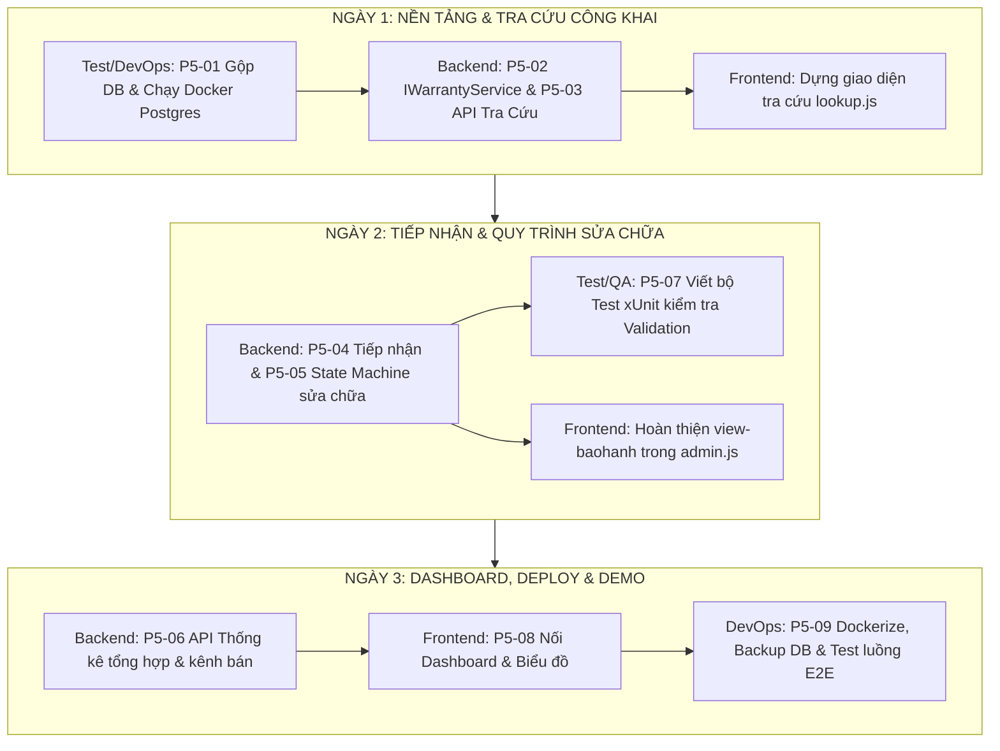

# KẾ HOẠCH HÀNH ĐỘNG 3 NGÀY & QUY CHUẨN CLEAN CODE
> **Dự án:** PhoneStoreManagementSystem (Backend C# .NET 10 + PostgreSQL + Frontend Vanilla JS)  
> **Áp dụng cho:** 3 phiên AI (Frontend, Backend, Test & DevOps)  
> **Thời lượng:** 3 Ngày (Mỗi ngày chia Ca Sáng & Ca Chiều)

---

# PHẦN 1. QUY CHUẨN VIẾT CODE SẠCH (CLEAN CODE & COMMENT RULES)

### 1. Quy tắc Comment (Bắt buộc tuân thủ)
- **TUYỆT ĐỐI KHÔNG dùng comment dạng `/// 
` (XML Documentation):** Không sinh các khối `
`, `<param>`, `<returns>` dài dòng làm loãng code và tăng dung lượng file không cần thiết.
- **TUYỆT ĐỐI KHÔNG comment bừa bãi, dịch lại code:** 
  - ❌ *Cấm viết:* `// Khởi tạo biến tổng tiền = 0`, `// Lưu vào database`, `// Trả về kết quả 200`.
- **Chỉ comment TẠI SAO (Why), không comment CÁI GÌ (What):**
  - Chỉ viết comment ngắn gọn (1 dòng với `//`) khi giải thích một quy tắc nghiệp vụ đặc thù, một ràng buộc cơ sở dữ liệu ngầm, hoặc một trường hợp ngoại lệ.
  - ✔️ *Đúng:* `// Bỏ qua tạo phiếu nếu thời hạn bảo hành = 0 theo quy định cửa hàng`
  - ✔️ *Đúng:* `// Npgsql bắt buộc DateTime phải là UTC khi ghi vào cột timestamptz`
- **Code tự giải thích (Self-Documenting Code):**
  - Tên hàm, tên biến phải rõ nghĩa bằng tiếng Anh hoặc tiếng Việt chuẩn theo đúng domain (ví dụ: `CalculateRemainingWarrantyDays`, `IsWarrantyExpired`).
  - Sử dụng **Guard Clauses (Return Early)**: Kiểm tra điều kiện sai và thoát/ném lỗi ngay ở đầu hàm, tránh lồng ghép `if-else` quá 2 tầng.

### 2. Quy chuẩn C# Backend (.NET 10)
- **Controller mỏng (Skinny Controller):** Action chỉ làm 3 việc: Nhận request -> Gọi Service -> Trả HTTP response. Toàn bộ logic, tính toán, kiểm tra nghiệp vụ nằm trong Service.
- **DTO độc lập:** Không bao giờ trả trực tiếp Entity ra Controller. DTO Request và Response phải tách bạch.
- **Validation:** Không kiểm tra `if (request.Ten == null)` rải rác trong Controller; toàn bộ validation đẩy vào class riêng kế thừa `AbstractValidator<T>` (FluentValidation).
- **Xử lý lỗi:** Không `try-catch` nuốt lỗi hoặc `catch (Exception)` chung chung trong Service; hãy ném `AppException(message, statusCode)` để Global Exception Middleware tự động format thành `{ "message": "...", "errors": [...] }`.
- **Truy vấn cơ sở dữ liệu:** Mọi truy vấn chỉ đọc bắt buộc thêm `.AsNoTracking()`. Mọi thao tác ghi từ 2 bảng trở lên bắt buộc dùng `await using var tx = await _context.Database.BeginTransactionAsync()`.

### 3. Quy chuẩn JavaScript Frontend
- **Hàm đơn nhiệm (Single Responsibility):** Tách bạch rõ ràng giữa:
  1. Hàm gọi API (nằm trong `api.js` hoặc module fetch).
  2. Hàm xử lý logic dữ liệu.
  3. Hàm render HTML vào DOM.
- **Bắt lỗi giao diện:** Bắt lỗi từ `api.js` thông qua `try-catch`, lấy `err.message` hiển thị qua Toast/Notification UI, không dùng `alert()` của trình duyệt.
- **Xử lý bất đồng bộ:** Sử dụng `async/await` nhất quán, không lồng `then().catch()` phức tạp. Luôn có cờ loading / disable nút bấm khi đang gửi request để chống người dùng spam click.

---

# PHẦN 2. CHI TIẾT CÔNG VIỆC 3 NGÀY CHO 3 PHIÊN

---

## 📅 CHI TIẾT NGÀY 1: NỀN TẢNG DATABASE & TRA CỨU BẢO HÀNH (P5-01, P5-02, P5-03)

### Ca Sáng (8h00 - 12h00)
* **Phiên Test & DevOps (Chủ trì nền tảng):**
  - Thực hiện **P5-01**: Tách và tạo `database/initdb/01-schema.sql` (bảng, index, seed) và `02-logic.sql` (view, trigger, procedure), loại bỏ toàn bộ phần trùng lặp giữa `Table.sql`, `Code.sql` và `init-postgres.sql`.
  - Cập nhật volume mount `/docker-entrypoint-initdb.d` trong `docker-compose.yml`.
  - Khởi động DB bằng `docker compose up -d postgres`, kiểm tra sự tồn tại của trigger `trg_imei_kiemtra` và `trg_chitiethoadon_tongtien`.
* **Phiên Backend:**
  - Định nghĩa interface `IWarrantyService` tại `backend/Features/Warranty/IWarrantyService.cs`:
    `Task CreateForInvoiceAsync(string soHD, string maIMEI, string maHang);`
  - Viết DTO `WarrantyLookupDto`: Chỉ bao gồm `tenHang`, `soIMEI`, `ngayBD`, `ngayKT`, `trangThai`, `soNgayConLai` (bảo mật: không có trường tên khách hay số điện thoại).
  - Cài đặt `WarrantyService.CreateForInvoiceAsync` (P5-02): Sinh mã qua `ICodeGenerator`, tính `NgayKT = NgayBD.AddMonths(thoiHanBaoHanh)`, bỏ qua nếu thời hạn = 0.
* **Phiên Frontend:**
  - Rà soát `frontend/js/lookup.js` phần tra cứu bảo hành qua IMEI.
  - Dựng sẵn khung render thẻ kết quả tra cứu: hiển thị trạng thái (còn hạn/hết hạn), số ngày còn lại, có thanh loading trạng thái.

### Ca Chiều (13h30 - 18h00)
* **Phiên Backend:**
  - Triển khai **P5-03**: 2 API công khai trong `WarrantyController.cs`:
    - `GET /api/baohanh/imei/{imei}`: Tra cứu chi tiết bảo hành theo số IMEI.
    - `GET /api/baohanh/trangthai/{imei}`: Kiểm tra nhanh trạng thái bảo hành.
  - Áp dụng Rate Limiting chống spam tra cứu. Nếu không tìm thấy IMEI, trả về mã **404** kèm `{ "message": "Không tìm thấy thông tin bảo hành cho IMEI này." }`.
* **Phiên Frontend:**
  - Thay thế dữ liệu mock trong `lookup.js` bằng lệnh gọi API thật qua `api.js`.
  - Xử lý thông báo lỗi đẹp mắt khi tra cứu IMEI không tồn tại (bắt lỗi 404).
* **Phiên Test / QA:**
  - Viết Unit Test đầu tiên trong `backend.Tests/` kiểm thử logic `IWarrantyService.CreateForInvoiceAsync` (test trường hợp có bảo hành và thời hạn bằng 0).
* **Tiêu chí nghiệm thu Ngày 1:**
  1. Docker DB chạy mượt mà từ máy sạch.
  2. Tra cứu thử 1 IMEI có sẵn trên giao diện web trả về kết quả chuẩn, không lộ thông tin khách hàng.

---

## 📅 CHI TIẾT NGÀY 2: TIẾP NHẬN & QUẢN LÝ QUY TRÌNH SỬA CHỮA (P5-04, P5-05, P5-07)

### Ca Sáng (8h00 - 12h00) - Nghiệp vụ Tiếp nhận (P5-04)
* **Phiên Backend:**
  - Tạo DTO và FluentValidation cho tiếp nhận bảo hành (`CreateTiepNhanRequest`, `UpdateTiepNhanRequest`).
  - Viết API `POST /api/tiepnhanbaohanh`:
    - Sinh mã tiếp nhận qua `ICodeGenerator`.
    - Lấy `MaNV_TiepNhan` trực tiếp từ JWT (`ICurrentUser`), không nhận từ client.
    - Kiểm tra bảo hành còn hạn; nếu hết hạn trả mã **400** `{ "message": "Sản phẩm đã hết hạn bảo hành." }`.
    - Trạng thái khởi tạo: `tiep_nhan`.
  - Viết API `GET /api/tiepnhanbaohanh`: Hỗ trợ lọc theo trạng thái, ngày tiếp nhận, kỹ thuật viên, phân trang `page`/`pageSize`, trả tổng số lượng trong header `X-Total-Count`.
  - Viết API `PUT /api/tiepnhanbaohanh/{ma}`: Gán kỹ thuật viên, chi phí sửa chữa >= 0, kết quả kiểm tra. Validate kỹ thuật viên phải có chức vụ `Kỹ thuật & Bảo hành`, sai chức vụ trả lỗi **400**.
* **Phiên Frontend:**
  - Hoàn thiện giao diện `view-baohanh` trong `frontend/admin.html`.
  - Viết hàm render bảng danh sách phiếu tiếp nhận bảo hành trong `frontend/js/admin.js`, có phân trang và bộ lọc trạng thái.

### Ca Chiều (13h30 - 18h00) - State Machine Sửa chữa & Kiểm thử (P5-05, P5-07)
* **Phiên Backend:**
  - Triển khai **P5-05**: API `PUT /api/tiepnhanbaohanh/{ma}/trangthai` với payload `{ "trangThai": "..." }`.
  - Kiểm tra nghiêm ngặt State Machine:
    - `tiep_nhan` ➔ `dang_sua`
    - `dang_sua` 🔁 `cho_linh_kien`
    - `dang_sua` hoặc `cho_linh_kien` ➔ `hoan_thanh`
    - `hoan_thanh` ➔ `da_tra`
    - Mọi bước nhảy trạng thái khác đều trả về mã **409 Conflict** `{ "message": "Chuyển trạng thái không hợp lệ." }`.
  - Khi trạng thái chuyển thành `da_tra`: Tự động gán `NgayTra = DateTime.UtcNow`.
  - Phân quyền: Chỉ cho phép các vai trò `tech`, `manager`, `admin` cập nhật trạng thái.
* **Phiên Frontend:**
  - Thêm modal/nút chuyển trạng thái nhanh trên từng dòng của bảng danh sách bảo hành trong `admin.js`.
  - Tích hợp gọi API cập nhật trạng thái và tự động tải lại bảng dữ liệu.
* **Phiên Test / QA:**
  - Viết integration test toàn diện cho State Machine: Viết test pass cho từng bước chuyển hợp lệ; viết ít nhất 3 test cases chuyển trạng thái bất hợp lệ (kỳ vọng trả về đúng 409).
  - Viết test case chặn gán nhân viên sai role (kỳ vọng trả về 400).
* **Tiêu chí nghiệm thu Ngày 2:**
  1. Thao tác tiếp nhận 1 máy bảo hành trên giao diện admin thành công.
  2. Thử chuyển trạng thái từ `tiep_nhan` sang `hoan_thanh` bị chặn lỗi 409 ngay lập tức.
  3. Bộ test tự động của module Bảo hành chạy pass 100%.

---

## 📅 CHI TIẾT NGÀY 3: DASHBOARD THỐNG KÊ, DEPLOY & DEMO CUỐI KỲ (P5-06, P5-08, P5-09)

### Ca Sáng (8h00 - 12h00) - Dashboard Thống kê (P5-06, P5-08)
* **Phiên Backend:**
  - Triển khai **P5-06** trong `backend/Features/Dashboard/`:
    - `GET /api/thongke/tonghop`: Trả về `doanhThuHomNay`, `doanhThuThang`, `soHoaDonHomNay`, `donOnlineChoXacNhan`, `soMatHangSapHet`, `soBaoHanhDangXuLy`.
    - `GET /api/thongke/kenhban?tuNgay&denNgay`: Thống kê doanh thu và số hóa đơn theo kênh bán (online/offline).
    - `GET /api/thongke/nhomhang?tuNgay&denNgay`: Doanh thu và số lượng theo từng nhóm hàng.
  - Phân quyền: Chỉ `admin` và `manager` được phép truy cập.
  - Cài đặt In-Memory Cache 30 giây để tối ưu hiệu năng.
* **Phiên Frontend:**
  - Triển khai **P5-08**: Nối API vào `view-dashboard` trong `frontend/js/admin.js`.
  - Render các thẻ KPI thống kê tổng hợp.
  - Vẽ biểu đồ kênh bán và nhóm hàng (dùng Chart.js hoặc Canvas thuần).
* **Phiên Test / QA:**
  - Viết test kiểm thử đối soát số liệu Dashboard: Tạo một số hóa đơn giả lập và kiểm tra API trả về doanh thu khớp 100% với tổng tiền hóa đơn.

### Ca Chiều (13h30 - 18h00) - Deploy & Kịch bản Tích hợp Demo (P5-09)
* **Phiên Test & DevOps (Chủ trì triển khai):**
  - Tối ưu Dockerfile: Đảm bảo có `curl` trong base image để lệnh healthcheck trong `docker-compose.yml` chạy đúng, không làm treo frontend khi chờ backend khởi động.
  - Chuyển toàn bộ JWT Key, chuỗi kết nối Database từ hardcode sang biến môi trường trong file `.env`.
  - Viết script sao lưu dữ liệu `database/backup.sh` (sử dụng `pg_dump`) và kịch bản phục hồi khi xảy ra sự cố.
* **Cả 3 phiên phối hợp Diễn tập Kịch bản E2E (End-to-End Test):**
  1. Nhập hàng 2 chiếc điện thoại mới kèm danh sách số IMEI vào kho.
  2. Bán 1 máy cho khách hàng -> Kiểm tra hóa đơn sinh ra và trigger tự động tạo bản ghi bảo hành có hạn 12 tháng.
  3. Lên trang tra cứu công khai `lookup.html`, nhập số IMEI để kiểm tra hạn bảo hành.
  4. Mở trang Admin tạo phiếu tiếp nhận bảo hành cho chiếc máy đó -> Phân công KTV -> Chuyển qua các bước sửa chữa -> Hoàn thành & Trả máy.
  5. Mở Dashboard kiểm tra số liệu doanh thu hôm nay và số ca bảo hành đã xử lý nhảy số chính xác.
* **Tiêu chí nghiệm thu Ngày 3:**
  1. Dự án chạy trơn tru toàn bộ bằng lệnh `docker compose up`.
  2. Luồng demo hoạt động không có bất kỳ lỗi 500 hay dữ liệu cứng nào.

---

# PHẦN 3. BẢNG TỔNG HỢP PROMPT KÍCH HOẠT THEO NGÀY

| Phiên | Prompt dán vào đầu ngày làm việc |
| :--- | :--- |
| **Backend (Sáng Ngày 1)** | `Bắt đầu Sáng Ngày 1: Đọc kỹ file guidelines/KE_HOACH_3_NGAY_VA_QUY_CHUAN_CODE.md. Hãy triển khai Task P5-02 và chuẩn bị DTO P5-03: Viết IWarrantyService, WarrantyService.CreateForInvoiceAsync, và DTO WarrantyLookupDto (ẩn thông tin khách hàng). Tuân thủ clean code: không dùng /// 
, comment ngắn gọn giải thích lý do, ném AppException.` |
| **Frontend (Sáng Ngày 1)** | `Bắt đầu Sáng Ngày 1: Đọc kỹ file guidelines/KE_HOACH_3_NGAY_VA_QUY_CHUAN_CODE.md. Rà soát file frontend/js/lookup.js phần tra cứu bảo hành theo IMEI, chuẩn bị hàm nhận kết quả từ API GET /api/baohanh/imei/{imei} với DTO { tenHang, soIMEI, ngayBD, ngayKT, trangThai, soNgayConLai }. Không dùng alert(), hiển thị trạng thái loading rõ ràng.` |
| **Test/DevOps (Sáng Ngày 1)** | `Bắt đầu Sáng Ngày 1: Đọc kỹ file guidelines/KE_HOACH_3_NGAY_VA_QUY_CHUAN_CODE.md. Bắt tay làm Task P5-01: Gộp script database/initdb/01-schema.sql và 02-logic.sql, cập nhật docker-compose.yml và chạy thử nghiệm thu các trigger trg_imei_kiemtra, trg_chitiethoadon_tongtien.` |
